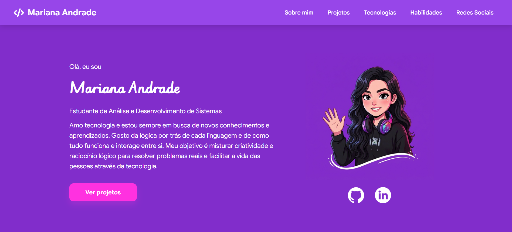

# Meu Portfólio

## Descrição

Site desenvolvido com o objetivo de apresentar meu perfil profissional, minhas habilidades, conhecimentos e projetos na área de tecnologia.

## Conteúdo

- Sobre mim
- Projetos
- Tecnologias e ferramentas
- Habilidades e conhecimentos
- Redes sociais

## Tecnologias

- HTML
- CSS
- JavaScript
- Ícones do site Lucide ( https://lucide.dev/icons/ )

## Atualizações

A versão inicial do projeto está concluída, mas o portfólio continuará recebendo atualizações com a inclusão de novos projetos, tecnologias aprendidas, experiências e habilidades adquiridas ao longo da minha trajetória profissional.

## Como acessar

O site está publicado no GitHub Pages. Para acessá-lo, clique no link abaixo:

https://anamarih732.github.io/Meu-Portfolio/